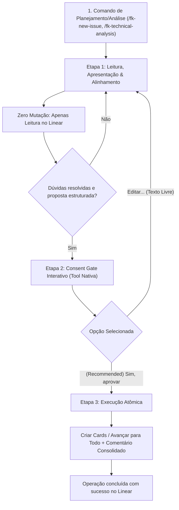

# Linear Workflow: Seamless Task Tracking, Lifecycle Commands & Consent Gate

A standardized workflow for AI coding agents to integrate Linear issue management directly into development and planning lifecycles. Supports native Linear MCP servers and provides a standalone zero-dependency Python CLI helper (`scripts/linear_api.py`) for GraphQL API execution with built-in comment idempotency, atomic updates, and automated state resolution.

---

## Core Non-Negotiable Standards

1. **Zero Hardcoded Secrets & Dynamic Credential Resolution**:
   - Never hardcode tokens or API keys into prompts, code, or configuration files.
   - Dynamically discover credentials in priority order:
     1. Linear MCP server tools (`linear_issue_search`, `linear_create_issue`, etc.), if present.
     2. Environment variable: `LINEAR_API_KEY` or `LINEAR_TOKEN`.
     3. Project-level `.linear.json`, `.linearrc`, or `.env`.
   - If no credentials exist, warn the user once and continue the development task without blocking.

2. **Non-Blocking Project Fallback**:
   - If the project does not exist in Linear, **never halt or abort** the user's task.
   - Proceed with development or implementation normally.
   - Inform the user clearly at the start or completion that the project is not tracked in Linear.

3. **Lifecycle State Machine & Responsabilidades de Transição**:
   - Enforce the official state progression:
     `Backlog` ➔ `Technical Analysis` ➔ `Todo` ➔ `In Progress` ➔ `In Review` ➔ `Done` (plus `Canceled` or `Duplicate`).
   - **Transições do Agente (Anti-Estagnação)**:
     - Conclusão de Análise Técnica: Agente move de `Technical Analysis` ➔ **`Todo`** com comentário estruturado.
     - Início de Desenvolvimento: Agente move de `Todo` ➔ **`In Progress`** com branch Git criada.
     - Conclusão de Desenvolvimento (PR Aberto): Agente move obrigatoriamente de `In Progress` ➔ **`In Review`** com link do PR e sumário técnico.
     - Correções de Code Review (`/fk-fix`): Agente move de `In Review` ➔ **`In Progress`** (início do fix) ➔ **`In Review`** (após commits e push).
   - **Rito Exclusivamente Manual a partir de `In Review`**:
     - A partir de **`In Review`**, o controle é **exclusivamente manual pelo desenvolvedor**.
     - **`Done`**: O desenvolvedor move manualmente para **`Done`** após revisar o PR no GitHub, validar os testes e realizar o merge. O agente **NUNCA** move o card para `Done`.
     - **Retorno para Correções**: Se o desenvolvedor encontrar falhas ou pedir ajustes durante o review, o card pode ser retornado para **`In Progress`** (manualmente ou via comando `/fk-fix`) para que o agente execute o ciclo corretivo.

4. **Mandatory 3-Stage Protocol (*Consent Gate*) for Planning/Analysis & Autonomous Execution Exception**:
   - For planning and analysis lifecycle commands (`/fk-new-issue`, `/fk-technical-analysis`) and natural language triggers, the agent must strictly follow this protocol across all harnesses (Google Antigravity, Claude Code, OpenCode, Cursor, GitHub Copilot):
     - **Stage 1 (Initial Presentation, Pre-Render Gate & Questions)**: The agent prepares the plan/analysis in chat/workspace, raising options and doubts with the developer. **Zero mutation**: No API calls altering Linear (`update-issue`, `create-issue`, `create-comment`) are permitted in this stage. Only read queries (`get-issue`, `search-issues`, `list-states`, `list-projects`) are allowed. **Pre-Render Gate (Proibição de Consent Gate Cego)**: It is **strictly forbidden** to invoke `ask_question` / `AskUserQuestion` without first rendering the complete proposal (full task decomposition table in `/fk-new-issue` or the revised card title, updated card description, and all 5 mandatory sections in `/fk-technical-analysis`) in the visible text of the chat message.
     - **Stage 2 (Consent Gate - Interactive Prompt with Concise Summary & Options)**: After rendering the full proposal visibly in chat and resolving questions, the agent presents the consent confirmation using the **native question tool** of the active harness, embedding a **concise summary of the plan/analysis directly inside the `question` field** as an additional safeguard:
       - **Google Antigravity**: tool nativa `ask_question`.
       - **Claude Code**: tool nativa `AskUserQuestion`.
       - **OpenCode v2**: tool nativa de perguntas (`ask`/`question`).
       - **Fallback Textual (Cursor, Copilot, Gemini CLI ou sem tool nativa)**: Bloco formatado em Markdown no chat com opções estruturadas.
       - **Opções Estruturadas**:
         1. `(Recommended) Sim, aprovar`: Avança atomicamente para a Stage 3.
         2. `Editar...`: Permite texto livre para o desenvolvedor informar o que deseja ajustar. O agente recebe o feedback, **retorna à Stage 1**, ajusta o plano/análise e apresenta novamente antes de acionar um novo Consent Gate.
     - **Stage 3 (Atomic Execution - Move Card + Update Title/Description + Register Comment)**: Only after affirmative developer response (`Sim, aprovar`), execute the closing actions atomically on Linear (advancing the status, updating the card title and description in `/fk-technical-analysis`, registering the consolidated comment, or creating cards).
   - ⚠️ **Execução Autônoma para `/fk-develop` e `/fk-fix` (Sem Consent Gate)**:
     - Os comandos de ciclo de desenvolvimento (`/fk-develop`) e correção de review (`/fk-fix`) rodam **sem Consent Gate**.
     - **`/fk-develop`**: Ao ser invocado, o agente lê os requisitos, transiciona imediatamente o card para `In Progress`, cria a branch Gitflow, implementa código e testes sem pedir confirmação prévia e avança para `In Review` ao abrir o PR no GitHub. Dúvidas devem ser levantadas ao desenvolvedor somente em casos excepcionais de bloqueio real; se não for bloqueante, o agente decide tecnicamente, registra a premissa assumida no comentário do card/PR e prossegue.
     - **`/fk-fix`**: Executa diretamente a leitura do feedback do PR, move para `In Progress`, aplica ajustes na branch existente, comenta no PR e retorna para `In Review` sem requerer aprovação prévia.

5. **Comment Idempotency & AIG Compliance**:
   - In accordance with Linear's official [Agent Interaction Guidelines (AIG)](https://linear.app/developers/agents):
     - Clearly signal agent identity: prefix all comments with `🤖 **AI Agent Update**:`.
     - Align with Linear Git automation: use the standard branch format `<type>/<identifier>-<slug>` (e.g. `feat/RENT-104-user-auth`).
     - **Idempotency Protection**: `scripts/linear_api.py` inspects recent card comments to prevent duplicate comments with identical body/payload within a 10-minute window.

6. **Parent Project, Subproject & Tooling Component Labeling**:
   - Detect when a repository represents a subproject of a unified Linear project (e.g., local project `Rent Easy Frontend` or `Rent Easy Backend` mapping to parent Linear project `Rent Easy`) or a standalone tooling/skills package:
     - **`Front`**: Aplicações e pacotes de interface gráfica (Flutter, React, Vue, Angular, Next.js, Web, Mobile).
     - **`Back`**: Serviços, APIs e servidores de backend (Spring Boot, Node.js API, Java, Python FastAPI/Django/Flask, Go, Rust).
     - **`Feature` ou Sem Tag (Omissão de `--label`)**: Repositórios de tooling, pacotes de skills/prompts de IA (como `fk_apm`), CLIs, automações, bibliotecas agnósticas ou infraestrutura. Nesses repositórios, **não force `Back`** pela mera presença de scripts auxiliares em Python ou Shell; aplique `--label "Feature"` (para novas funcionalidades/melhorias de pacotes) ou omita o argumento `--label`.

7. **100% Transparency & User Notification**:
   - Every Linear operation (issue queried, card created, state transitioned, or comment added) must be explicitly communicated in the response with issue keys (e.g. `LIN-42`) and status.

8. **Multi-Harness Architecture Support**:
   - Standardized APM primitives under `.apm/skills/` (`SKILL.md`), `.apm/prompts/` (`.prompt.md`) and `.apm/instructions/` (`.instructions.md`) provide cross-platform command routing:
     - **Google Antigravity**: Native slash commands via promoted sub-skills in `.agents/skills/` (`/fk-new-issue`, `/fk-technical-analysis`, `/fk-develop`, `/fk-fix`), backed by unconditional rules in `.agents/rules/` and compiled `AGENTS.md`.
     - **Claude Code**: Native custom slash commands in `.claude/commands/` and rules in `.claude/rules/`.
     - **Cursor**: Custom slash commands in `.cursor/commands/` and rules in `.cursor/rules/`.
     - **GitHub Copilot**: Prompt templates in `.github/prompts/` and instructions in `.github/instructions/`.

9. **Shell Backtick & Markdown Payload Safety (`--description-file`, `--comment-file`, `--body-file`)**:
   - Passing Markdown payloads inline via command-line arguments (`linear_api.py --description "..." --comment "..."` or `gh pr create/comment --body "..."`) suffers from critical OS/shell corruption before reaching the target process:
     1. **Backtick Escape & Expansion**: In **Windows PowerShell**, double-quoted strings (`"..."`) treat the backtick (`` ` ``) as an escape character (`` `f `` ➔ Form Feed `\x0c`, `` `t `` ➔ Tab `\t`, `` `r `` ➔ Carriage Return `\r`, `` `b `` ➔ Backspace `\x08`, `` `n `` ➔ Newline `\n`, or strip standalone backticks), corrupting `` `feat` `` ➔ `eat`, `` `fix` `` ➔ `ix`, `` `test` `` ➔ `est`, `` `refactor` `` ➔ `efactor`, and `` `chore` `` ➔ `chore`. In **Bash/Zsh**, backticks inside `"..."` trigger command substitution.
     2. **Win32 Double-Quote Stripping (`CommandLineToArgvW`)**: In Windows PowerShell 5.1, passing strings or variables with internal double quotes (`"`) to native binaries (`python`, `gh`) fails to escape quotes in `lpCommandLine`, causing `CommandLineToArgvW` to split arguments or strip quotes from Markdown payloads.
   - **Mandatory File-First Standard**: Write Markdown descriptions, comments, and PR bodies to temporary UTF-8 files (using the agent's native file tool or `Set-Content -Path <file> -Encoding utf8` with `@' ... '@` in PowerShell / `cat <<'EOF' > <file>` in Bash) and pass `--description-file "<path>"`, `--comment-file "<path>"`, and `--body-file "<path>"`.
   - **Deterministic Markdown Sanitizer (`sanitize_markdown_payload`)**: `scripts/linear_api.py` automatically runs `sanitize_markdown_payload` on all descriptions and comments before GraphQL execution (and exposes the `sanitize-markdown` CLI subcommand), normalizing `\r\n` to `\n`, stripping invalid ASCII control characters, aligning Markdown table pipes, and auto-closing unclosed fenced code blocks (```` ``` ````).
   - **Explicit Prohibition**: **Never** pass Markdown containing backticks (`` ` ``), code blocks, or double quotes directly via inline `--description "..."`, `--comment "..."`, or `--body "..."`.

10. **Spec-Driven Development (`spec-kit`), Cognitive Scaffolding & Executive Briefing**:
    - **Repository Constitution (`.speckit/constitution.md`)**: Architectural principles and non-negotiable engineering standards live in `.speckit/constitution.md`. Agents must read this file (when present) as Cognitive Scaffolding before authoring technical plans.
    - **Local Versioned Spec Layer (`.specs/<issue-key>/`)**:
      - `.specs/<issue-key>/spec.md`: Functional requirements, user/system scenarios, and acceptance criteria (generated optionally in `/fk-new-issue` or refined in `/fk-technical-analysis`).
      - `.specs/<issue-key>/plan.md`: Complete 5-section architectural and technical design (`Diagnóstico e Contexto`, `Arquitetura da Solução & Desenho Técnico`, `Checklist de Arquivos Impactados`, `Estratégia de Testes`, `Plano Gitflow`).
      - `.specs/<issue-key>/tasks.md`: Ordered, atomic implementation checklist (`- [ ]` / `- [x]`) consumed and updated progressively during `/fk-develop`.
    - **Static Integrity Validation (`validate-plan`)**: Before triggering the Stage 2 Consent Gate in `/fk-technical-analysis`, run `python skills/linear-workflow/scripts/linear_api.py validate-plan <issue-key>` to verify mandatory sections, valid repository file paths, and actionable tasks.
    - **Executive Briefing Standard (Chat & Linear)**: Instead of dumping massive walls of Markdown into chat or Linear comments, present a concise **10-15 line Executive Briefing** containing key metrics (impacted files count, tasks count, target branch), the **Título Revisado**, the **Descrição Atualizada**, a compact synthesis of the 5 mandatory sections, and the path reference to `.specs/<issue-key>/`.

---

## Lifecycle Commands Reference

| Canonical Trigger | Slash-Free Variant | Target State Transition | Executado Por | Scope & Purpose |
| :--- | :--- | :--- | :--- | :--- |
| **`/fk-new-issue`** | `fk-new-issue` | `Backlog` (padrão; `Todo` só em exceção explícita) | **Agente** (com Consent Gate) | Planejamento, decomposição e criação atômica de novos cards no Linear. |
| **`/fk-technical-analysis`** | `fk-technical-analysis` | `Technical Analysis` ➔ `Todo` | **Agente** (com Consent Gate) | Investigação arquitetural, spikes técnicos, desenho de solução e avanço para `Todo` ao concluir. |
| **`/fk-develop`** | `fk-develop` | `Todo` ➔ `In Progress` ➔ `In Review` | **Agente** (sem Consent Gate, autônomo) | Início imediato do desenvolvimento (`In Progress`), criação de branch Gitflow, implementação autônoma, testes e avanço para `In Review` ao abrir o PR. |
| **`/fk-fix`** | `fk-fix` | `In Review` ➔ `In Progress` ➔ `In Review` | **Agente** (sem Consent Gate) | Aplica correções do review de um PR aberto (lê reviews, inline comments e texto extra), comita na branch, comenta no PR e devolve o card para `In Review`. |
| *(Transição Manual)* | — | `In Review` ➔ `Done` | **Desenvolvedor** | **Exclusivamente manual pelo desenvolvedor** após merge e homologação da entrega. |

---

## Tool Execution Matrix (MCP vs Bundled CLI)

The agent dynamically uses whatever tool is available in the current environment:

| Operation | Official Linear MCP (`https://mcp.linear.app/mcp`) | Bundled CLI (`python skills/linear-workflow/scripts/linear_api.py`) |
| :--- | :--- | :--- |
| **Verify Auth** | OAuth 2.1 via Linear MCP | `python <skill-dir>/scripts/linear_api.py auth-check` |
| **Find Project** | `linear_list_projects` | `python <skill-dir>/scripts/linear_api.py find-project "<name>"` |
| **Get Issue** | `linear_issue_search` | `python <skill-dir>/scripts/linear_api.py get-issue "<key-or-id>"` |
| **Search Issue** | `linear_issue_search` | `python <skill-dir>/scripts/linear_api.py search-issues "<term>" [--project-id "<id>"]` |
| **Create Card** | `linear_create_issue` | `python <skill-dir>/scripts/linear_api.py create-issue --team-id "<tid>" --project-id "<pid>" --title "<title>" --description-file "<path>" --state "<state>" --label "Front"` |
| **Atomic Update** | `linear_update_issue` + `linear_create_comment` | `python <skill-dir>/scripts/linear_api.py update-issue "<id>" [--team-id "<tid>"] [--state "<state>"] [--title "<title>"] [--description-file "<path>"] [--comment-file "<path>"]` |
| **Add Comment** | `linear_create_comment` | `python <skill-dir>/scripts/linear_api.py update-issue "<id>" --comment-file "<path>"` *(idempotente)* |
| **Validate Plan** | *(Local Static CLI)* | `python <skill-dir>/scripts/linear_api.py validate-plan "<issue-key>"` *(sem API key)* |
| **Sanitize Markdown** | *(Local Static CLI)* | `python <skill-dir>/scripts/linear_api.py sanitize-markdown "<file.md>" [--in-place]` *(sem API key)* |

---

## Workflow 1: Protocolo Universal Consent Gate em 3 Etapas

Para comandos de planejamento e análise técnica (`/fk-new-issue`, `/fk-technical-analysis`), segue-se rigorosamente este fluxo:



### Mecanismo de Pergunta Interativa por Harness:
- **Google Antigravity**: Dispara a tool nativa `ask_question` com opções `["(Recommended) Sim, aprovar", "Editar..."]`.
- **Claude Code**: Dispara a tool nativa `AskUserQuestion` com opções `["Sim, aprovar", "Editar..."]`.
- **OpenCode v2**: Dispara a tool nativa de perguntas (`ask`/`question`) com opções `["Sim, aprovar", "Editar..."]`.
- **Fallback Textual (Cursor, Copilot, Gemini CLI ou sem suporte a tool)**: Exibe a pergunta no chat em bloco Markdown destacado:
  ```markdown
  > [!IMPORTANT]
  > **Consent Gate (Confirmação Explícita)**:
  > <pergunta de consentimento>
  > - **1. (Recomendado) Sim, aprovar**: Prosseguir com a execução atômica no Linear.
  > - **2. Editar...**: Digite os ajustes desejados para revisarmos o plano na Etapa 1.
  ```
- **Semântica das Opções**:
  - `(Recommended) Sim, aprovar`: Autoriza imediatamente a transição para a **Etapa 3: Execução Atômica**.
  - `Editar...`: Permite texto livre para o desenvolvedor apontar ajustes no plano. O agente **retorna à Etapa 1**, reapresenta a proposta corrigida e aciona novo Consent Gate. **Zero mutação é mantida até aprovação explícita**.

---

## Workflow 2: Planejamento & Criação de Tarefas (`/fk-new-issue`)

Gatilhos: `/fk-new-issue`, `fk-new-issue`, *"vamos planejar tarefas"*, *"crie os cards para..."*.

1. **Etapa 1 - Apresentação & Dúvidas (Leitura e Renderização Prévia Obrigatória)**:
   - Localiza o projeto pai no Linear (`find-project`).
   - Decompõe os requisitos em tarefas atômicas no chat (título, descrição, critérios de aceitação, status `Backlog` por padrão e label: `Front`, `Back`, ou `Feature`/sem tag para repositórios de tooling, pacotes de skills/prompts e infraestrutura).
   - **Proibição de Consent Gate Cego**: Renderiza integralmente no texto visível do chat toda a tabela/lista de cards propostos antes de acionar a ferramenta de pergunta da Etapa 2, sem chamar `create-issue`.
2. **Etapa 2 - Consent Gate Interativo**:
   - Aciona a ferramenta interativa de perguntas do harness (ex: `ask_question` / `AskUserQuestion`) ou fallback textual com as opções `(Recommended) Sim, aprovar` e `Editar...`, incluindo obrigatoriamente um **resumo conciso do plano na própria pergunta**:
     - Pergunta: *"Resumo do plano (N cards em Backlog): 1) <título-1> [<label>]; 2) <título-2> [<label>]. O escopo e a divisão dos cards estão alinhados? Posso criá-los no Linear sob o status Backlog (padrão)?"*
   - Se o usuário escolher `Editar...`: coleta as correções em texto livre, retorna à Etapa 1 para atualizar a decomposição e reapresenta o Consent Gate.
3. **Etapa 3 - Execução Atômica**:
   - Somente após `Sim, aprovar`, cria os cards no Linear via CLI/MCP utilizando `--description-file "<path>"` (arquivo UTF-8 temporário sanitizado automaticamente por `sanitize_markdown_payload` para preservar crases e blocos de código sem corrupção de shell).
   - Opcionalmente, quando solicitado ou aplicável para features estruturais, gera o arquivo funcional inicial `.specs/<issue-key>/spec.md` com os requisitos e critérios de aceitação aprovados.
   - Apresenta o sumário final com links diretos e IDs.

---

## Workflow 3: Análise Técnica & Spikes Arquiteturais (`/fk-technical-analysis`)

Gatilhos: `/fk-technical-analysis`, `fk-technical-analysis`, *"vamos analisar tecnicamente o card X"*, *"faça um spike técnico sobre Y"*.

1. **Etapa 1 - Cognitive Scaffolding, Artefatos `.specs/<issue-key>/` & Executive Briefing (Zero Mutação no Linear)**:
   - Consulta o card via `get-issue` ou `search-issues` e lê `.speckit/constitution.md` (se existir no repositório) como Cognitive Scaffolding arquitetural.
   - Realiza a análise arquitetural, opções de implementação, trade-offs e impactos no workspace.
   - **Persistência Local Spec-Driven (`.specs/<issue-key>/`)**:
     - Cria/atualiza `.specs/<issue-key>/plan.md` contendo a especificação técnica detalhada com as 5 seções obrigatórias.
     - Cria/atualiza `.specs/<issue-key>/tasks.md` contendo o checklist atômico e ordenado de implementação (`- [ ]`).
     - Opcionalmente cria/atualiza `.specs/<issue-key>/spec.md` com os requisitos funcionais refinados.
   - **Validação Determinística (`validate-plan`)**:
     - Executa `python skills/linear-workflow/scripts/linear_api.py validate-plan <issue-key>` para assegurar que `plan.md` e `tasks.md` possuem todas as seções obrigatórias, caminhos de arquivos válidos e tarefas acionáveis antes do Consent Gate.
   - **Proibição de Consent Gate Cego & Padrão Executive Briefing**: Apresenta no texto visível do chat um **Executive Briefing** conciso (10-15 linhas com métricas-chave e link para `.specs/<issue-key>/`) contendo obrigatoriamente o **Título Revisado** e a **Descrição Atualizada** do card, além da síntese estruturada sob as **5 seções obrigatórias** antes de invocar `ask_question` / `AskUserQuestion`:
     - **Título Revisado do Card**: `<type>(<scope>): <resumo-tecnico-refinado>`
     - **Descrição Atualizada do Card**: Contexto, problema, escopo técnico refinado e critérios de aceitação atualizados.
     1. **Diagnóstico e Contexto**: Causa-raiz ou motivação técnica refinada.
     2. **Arquitetura da Solução & Desenho Técnico**: Decisões de design, contratos, trade-offs e dependências.
     3. **Checklist de Arquivos Impactados**: Caminhos explícitos de arquivos a criar, modificar ou remover.
     4. **Estratégia de Testes**: Validações automáticas, comandos e critérios técnicos.
     5. **Plano Gitflow**: Nome da branch (`<type>/<key>-<slug>`), Conventional Commits 1.0.0 e estado `Todo`.
   - **Zero mutação prematura no card**: Nenhum comentário preliminar ou mudança de estado é postada no Linear enquanto houver dúvidas em aberto.
2. **Etapa 2 - Consent Gate Interativo**:
   - Aciona a ferramenta interativa de perguntas do harness (ex: `ask_question` / `AskUserQuestion`) ou fallback textual com as opções `(Recommended) Sim, aprovar` e `Editar...`, incluindo obrigatoriamente um **resumo conciso da análise na própria pergunta**:
     - Pergunta: *"Resumo da análise (<issue-key>): <resumo-solucao> | Arquivos: <N> | Tasks: <M> | Branch: <branch>. A análise técnica (validada em .specs/<issue-key>/) está aprovada? Posso registrar as decisões no Linear e mover o card para **Todo** (pronto para desenvolvimento)?"*
   - Se o usuário escolher `Editar...`: recebe os direcionamentos técnicos adicionais, volta à Etapa 1 para refinar `.specs/<issue-key>/plan.md` e `tasks.md`, reexecuta `validate-plan` e reapresenta o Consent Gate.
3. **Etapa 3 - Execução Atômica & Persistência do Executive Briefing no Linear**:
   - Somente após `Sim, aprovar`, executa atomicamente a transição de estado para `Todo` acompanhada da **atualização obrigatória do título (`--title`) e da descrição do card (`--description-file`)** e postando o **Executive Briefing estruturado nas 5 seções** com referência para `.specs/<issue-key>/` no comentário consolidado (`--comment-file`):
     ```bash
     python skills/linear-workflow/scripts/linear_api.py update-issue "<id>" \
       --state "Todo" \
       --title "<titulo-revisado>" \
       --description-file "<descricao-utf8.md>" \
       --comment-file "<executive-briefing-5-secoes-utf8.md>"
     ```
   - Sempre utilize arquivos UTF-8 temporários (`--description-file "<path>"` e `--comment-file "<path>"`, sanitizados automaticamente por `sanitize_markdown_payload`) no mesmo comando atômico `update-issue` junto a `--state "Todo"` e `--title "<titulo-revisado>"` para evitar corrupção de crases (`` `feat` ``, `` `fix` ``, etc.) e aspas duplas no PowerShell/Bash. Substitua sempre títulos ou descrições preliminares de `Backlog` pelo contexto técnico refinado.
   - O card avança formalmente para **`Todo`** e não permanece em `Technical Analysis`.

---

## Workflow 4: Ciclo Autônomo de Desenvolvimento & Implementação (`/fk-develop`)

Gatilhos: `/fk-develop`, `fk-develop`, *"vamos desenvolver a tarefa X"*, *"quero implementar o card Y"*.

> [!IMPORTANT]
> **Execução Autônoma (SEM Consent Gate)**:
> O comando `/fk-develop` roda **sem Consent Gate**. A LLM transiciona o card imediatamente para **`In Progress`** e cria a branch de desenvolvimento sem solicitar confirmação prévia ao usuário.
>
> **Diretriz de Decisão**: A LLM **só deve perguntar ao desenvolvedor em casos excepcionais de ambiguidade real e bloqueante**. Comportamento padrão: decidir tecnicamente, registrar a premissa assumida no comentário do card/PR e seguir em frente.

1. **Leitura do Contrato Local (`.specs/<issue-key>/`) & Card no Linear**:
   - Lê o card (`get-issue <id>`) e verifica prioritariamente a existência dos artefatos locais em `.specs/<issue-key>/` (`tasks.md`, `plan.md`, `spec.md`), além de `.speckit/constitution.md`.
   - **Consome prioritariamente `.specs/<issue-key>/tasks.md` e `.specs/<issue-key>/plan.md`** como contrato técnico local confiável (usando o comentário `🤖 **AI Agent Update**: Análise Técnica Concluída` ou a descrição do card no Linear como fallback caso `.specs/<issue-key>/` ainda não exista).
   - Formata a branch Gitflow no padrão Linear `<type>/<key>-<slug>` conforme especificado em `plan.md` / análise técnica.
2. **Transição Imediata para `In Progress` no Linear**:
   - Move imediatamente o card para `In Progress` com comentário inicial (Executive Briefing) informando a branch e premissas assumidas (usando `--comment-file` para payloads Markdown com crases):
     ```bash
     python skills/linear-workflow/scripts/linear_api.py update-issue "<id>" --state "In Progress" --comment-file "<comentario-inicio-utf8.md>"
     ```
3. **Criação da Branch Gitflow & Codificação Autônoma Guiada por `tasks.md`**:
   - Garante base atualizada e cria/muda para a branch:
     ```bash
     git checkout -b <branch-name>
     ```
   - Implementa código e testes sem pedir confirmações intermediárias, **marcando progressivamente cada item concluído (`- [ ]` ➔ `- [x]`) no arquivo local `.specs/<issue-key>/tasks.md`**.
4. **Finalização do Desenvolvimento & Movimentação para `In Review`**:
   - Após implementar, validar os testes unitários e abrir o Pull Request no GitHub (`gh pr create --body-file "<pr-body-utf8.md>"`):
   - **O agente move obrigatoriamente o card para `In Review`**:
     ```bash
     python skills/linear-workflow/scripts/linear_api.py update-issue "<id>" --state "In Review" --comment-file "<comentario-pr-utf8.md>"
     ```
   - Notifica o desenvolvedor de que a tarefa está pronta para sua revisão manual.

---

## Workflow 5: Rito de Revisão Manual & Conclusão (`In Review` ➔ `Done`)

A partir da coluna **`In Review`**, o controle é exclusivamente manual pelo desenvolvedor:

1. **Revisão Humana do Pull Request**:
   - O desenvolvedor analisa o código no GitHub, valida os testes automatizados e a conformidade funcional.
2. **Cenário A: Necessidade de Correções / Ajustes (`/fk-fix`)**:
   - Quando houver comentários de revisão no PR ou solicitações de ajustes, o comando `/fk-fix` pode ser invocado (ex: `/fk-fix FAL-24` ou simplesmente `/fk-fix` na branch atual).
   - O agente assume as correções de forma autônoma sem Consent Gate (Workflow 6), atualiza a branch, comenta no PR e retorna o card para **`In Review`**.
3. **Cenário B: Aprovação & Merge**:
   - O desenvolvedor realiza o merge do PR no GitHub.
   - O **desenvolvedor move manualmente o card para `Done`**.
   - O agente nunca força a transição para `Done` sem intervenção humana no repositório remoto.

---

## Workflow 6: Aplicação Autônoma de Feedback de Code Review (`/fk-fix`)

Gatilhos: `/fk-fix`, `fk-fix`, *"aplicar correções do review"*, *"resolver feedback de code review no PR"*.

> [!IMPORTANT]
> **Execução Autônoma (SEM Consent Gate)**:
> Ao contrário de `/fk-new-issue` e `/fk-technical-analysis`, o comando `/fk-fix` roda **sem Consent Gate**. O desenvolvedor apenas invoca o comando e o agente executa atomicamente todo o fluxo até o retorno para **`In Review`**.

1. **Identificação do Card e do PR**:
   - Extrai a issue informada como argumento ou deduz pela branch Git atual (`<type>/<issue-key>-<slug>`).
   - Localiza o PR aberto correspondente à branch no GitHub via `gh pr view`.
2. **Leitura & Consolidação do Feedback**:
   - Coleta comentários gerais do PR (`gh pr view --comments`), reviews (`gh api .../reviews`) e inline review comments (`gh api .../comments`), além de instruções passadas pelo usuário no chat.
   - Filtra comentários de automação/agente (`🤖 **AI Agent Update**:`) e threads já resolvidas.
   - Se não houver comentários/reviews nem texto extra do usuário, finaliza sem mutação alertando o desenvolvedor.
3. **Movimentação do Card para In Progress (Sem Confirmação)**:
   - Transiciona imediatamente o card no Linear para **`In Progress`** com sumário dos itens em tratamento.
4. **Implementação & Testes na Branch Existente**:
   - Realiza correções nos arquivos do projeto e executa suíte de testes.
   - Cria commits semânticos e faz `git push origin <branch-name>` (atualizando o PR existente sem abrir um novo).
5. **Registro de Feedback no PR**:
   - Comenta no PR via `gh pr comment <pr-number> --body-file "<pr-comment-utf8.md>"` destacando itens corrigidos e eventuais decisões técnicas.
6. **Transição Final para In Review**:
   - Transiciona atomicamente o card para **`In Review`** no Linear via `--comment-file "<comentario-utf8.md>"`, notificando o desenvolvedor com sumário e link do PR.

---

## Complete Workflow Scenarios

### Example 1: Criação e Decomposição de Tarefas com Consent Gate
**Usuário**: `"/fk-new-issue planejar autenticação biométrica e recuperação de senha para Rent Easy"`  
**Agente (Etapa 1)**: Localiza o projeto pai `Rent Easy`, analisa o escopo e apresenta a proposta de cards no chat:
- `[FAL-30] feat(auth): implementar autenticação biométrica com LocalAuthentication (Label: Front)`
- `[FAL-31] feat(auth): implementar fluxo de recuperação de senha por email (Label: Front)`  
**Agente (Etapa 2 - Consent Gate Interativo)**: Invoca `ask_question`:
- Pergunta: *"O escopo e a divisão dos 2 cards estão aprovados para criação no Linear sob o status Backlog (padrão)?"*
- Opções: `["(Recommended) Sim, aprovar", "Editar..."]`  
**Usuário (Seleção)**: `"(Recommended) Sim, aprovar"`  
**Agente (Etapa 3)**: Cria atomicamente os cards no Linear e retorna links e IDs confirmados.

### Example 2: Consent Gate com Loopback ("Editar...") na Análise Técnica
**Usuário**: `"/fk-technical-analysis FAL-24"`  
**Agente (Etapa 1)**: Investiga a arquitetura, apresenta opções de solução no chat sem alterar o Linear.  
**Agente (Etapa 2 - Consent Gate Interativo)**: Invoca `ask_question`:
- Pergunta: *"A análise técnica está aprovada? Posso registrar as decisões e mover o card para **Todo**?"*
- Opções: `["(Recommended) Sim, aprovar", "Editar..."]`  
**Usuário (Seleção/Texto)**: `"Editar... incluir alternativa usando WebSockets"`  
**Agente (Retorno à Etapa 1)**: Não altera o Linear (Zero Mutação). Complementa a análise técnica incluindo trade-offs de WebSockets e reapresenta o estudo no chat.  
**Agente (Etapa 2 - Novo Consent Gate)**: Invoca novamente a tool de pergunta interativa.  
**Usuário**: `"(Recommended) Sim, aprovar"`  
**Agente (Etapa 3)**: Executa `update-issue FAL-24 --state "Todo" --title "..." --description-file "<desc-utf8.md>" --comment-file "<spec-utf8.md>"` e confirma a transição.

### Example 3: Ciclo Autônomo de Desenvolvimento com `/fk-develop` (Sem Consent Gate)
**Usuário**: `"/fk-develop FAL-24"`  
**Agente**:
1. Lê requisitos, critérios e comentários de FAL-24;
2. Transiciona imediatamente FAL-24 para **`In Progress`** via CLI com comentário (`--comment-file`) informando a branch `feat/FAL-24-biometric-auth`;
3. Cria a branch Gitflow e implementa o código e os testes sem solicitar confirmação intermediária;
4. Executa os testes unitários com sucesso, cria commit semântico e abre o Pull Request #5 no GitHub (`gh pr create --body-file "<pr-body-utf8.md>"`);
5. Transiciona obrigatoriamente FAL-24 para **`In Review`** no Linear com o link do PR e sumário técnico:
```bash
python skills/linear-workflow/scripts/linear_api.py update-issue FAL-24 --state "In Review" --comment-file "<comentario-pr-utf8.md>"
```

### Example 4: Correções de Review com `/fk-fix` (Sem Consent Gate)
**Usuário**: `"/fk-fix FAL-24 ajustar validação de email nulo"`  
**Agente**:
1. Localiza o PR #8 da branch `feat/FAL-24-auth` e lê comentários gerais, reviews e comentários inline;
2. Atualiza o card FAL-24 no Linear para **`In Progress`** com o resumo dos itens a corrigir;
3. Aplica a correção no código, executa os testes unitários, realiza commit semântico e faz `git push origin feat/FAL-24-auth`;
4. Comenta no PR #8 listando as alterações realizadas;
5. Atualiza o card FAL-24 no Linear para **`In Review`** e notifica o desenvolvedor no chat com o sumário da entrega.

---

## References

- [references/multi-harness-commands.md](references/multi-harness-commands.md) for cross-harness architecture (Antigravity, Claude, Cursor, Copilot) and APM primitives.
- [references/states-and-labels.md](references/states-and-labels.md) for full state definitions, subproject rules, and AIG compliance.
- [references/configuration.md](references/configuration.md) for API key setup and MCP integration.
- [Linear Developers: Agent Interaction Guidelines (AIG)](https://linear.app/developers/agents)
- [Linear Docs: Model Context Protocol (MCP)](https://linear.app/docs/mcp)
