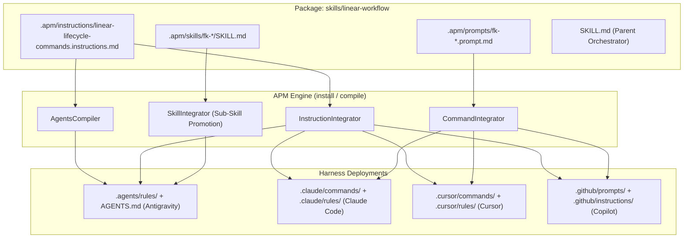

# Multi-Harness Lifecycle Commands Architecture & Reference

This reference documents how Linear lifecycle commands (`fk-new-issue`, `fk-technical-analysis`, `fk-develop`) operate across multiple AI coding harnesses (Google Antigravity, Claude Code, Cursor, and GitHub Copilot) through APM primitives.

---

## 1. Architectural Challenge Across Harnesses

Different AI coding harnesses implement command discovery and user inputs with distinct paradigms:

| Harness | Command Discovery Mechanism | Slash (`/`) Interception Behavior | Native Primitives Path |
| :--- | :--- | :--- | :--- |
| **Google Antigravity** (`agy` CLI / IDE) | Native slash commands via sub-skills (`.agents/skills/`) & rules (`.agents/rules/`) | Supports typeahead `/` commands via promoted sub-skills and progressive disclosure rules | Sub-skills: `.agents/skills/` Rules: `.agents/rules/` |
| **Claude Code** | Custom slash commands | Native support for project commands via Markdown files | Commands: `.claude/commands/` Rules: `.claude/rules/` |
| **Cursor** | Custom slash commands & Agent rules | Native commands & rules via MDC | Commands: `.cursor/commands/` Rules: `.cursor/rules/` |
| **GitHub Copilot** | Prompt files & Instruction sets | Discovers prompt files in project | Prompts: `.github/prompts/` Instructions: `.github/instructions/` |

Without harness-aware distribution:
- Antigravity would miss `.claude/commands/` entirely and rely solely on LLM guessing from skill descriptions.
- Users typing `/fk-dev` in CLI harnesses might collide with CLI-level parsing.
- Syntactic friction (e.g., typing `fk-dev` without a slash) could prevent skill triggering.

---

## 2. Multi-Harness Solution via APM Primitives

`linear-workflow` uses APM dual primitives to guarantee seamless execution regardless of the user's active harness:

### 1. Primitives: `.apm/prompts/*.prompt.md`
- Deployed by APM `CommandIntegrator` / `PromptIntegrator` to:
  - Claude Code: `.claude/commands/fk-new-issue.md`, `fk-technical-analysis.md`, `fk-develop.md`
  - Cursor: `.cursor/commands/fk-new-issue.md`, `fk-technical-analysis.md`, `fk-develop.md`
  - Copilot: `.github/prompts/fk-new-issue.prompt.md`, `fk-technical-analysis.prompt.md`, `fk-develop.prompt.md`
- Preserves metadata: `description`, `argument-hint`, `allowed-tools`.

### 2. Primitives: `.apm/instructions/*.instructions.md`
- Deployed by APM `InstructionIntegrator` to:
  - Antigravity: `.agents/rules/linear-lifecycle-commands.md` (unconditional rule)
  - Claude Code: `.claude/rules/linear-lifecycle-commands.md` (unconditional rule)
  - Cursor: `.cursor/rules/linear-lifecycle-commands.mdc`
  - GitHub Copilot: `.github/instructions/linear-lifecycle-commands.instructions.md`
- Injected by APM `AgentsCompiler` into `AGENTS.md` and `CLAUDE.md`.

---

## 3. Syntactic Tolerance Standard

Agents must recognize all syntax permutations interchangeably:

| Canonical Command | Slash-Free Variant | Quick Alias | Natural Language Equivalent |
| :--- | :--- | :--- | :--- |
| `/fk-new-issue` | `fk-new-issue` | `/fk-issue`, `fk-issue` | *"vamos planejar tarefas no Linear"*, *"crie os cards para..."* |
| `/fk-technical-analysis` | `fk-technical-analysis` | `/fk-ta`, `fk-ta` | *"vamos analisar o card FAL-12"*, *"spike técnico do FAL-12"* |
| `/fk-develop` | `fk-develop` | `/fk-dev`, `fk-dev` | *"vamos desenvolver a tarefa FAL-12"*, *"implementar o card FAL-12"* |

No matter which syntax the user inputs:
1. The agent intercepts the trigger immediately.
2. The agent reads context (zero mutation in Linear).
3. The agent passes through the mandatory **Consent Gate**.
4. The agent executes atomically on Linear upon developer approval.

---

## 4. Consent Gate Behavioral Guarantee

Regardless of whether a command was triggered via a native slash command (`/fk-develop FAL-25`) or a plain prompt (`fk-develop FAL-25` or natural language):

- **No Premature Mutation**: Linear state updates, comment creation, and card creation are strictly forbidden before developer consent.
- **Stage 1**: Query card, present plan or architecture, discuss trade-offs.
- **Stage 2**: Ask explicit approval (*"O plano está aprovado? Posso mover o card para [Status]?"*).
- **Stage 3**: On affirmative answer, update Linear state atomically and proceed.
