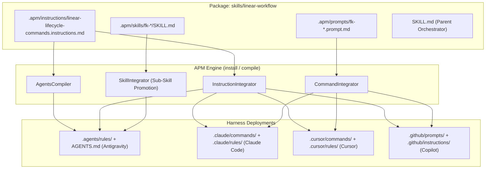
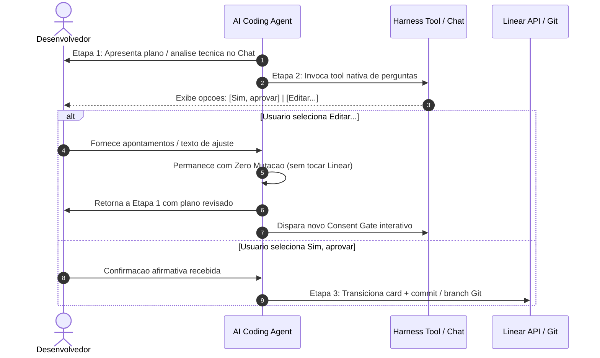

# Multi-Harness Lifecycle Commands Architecture & Reference

This reference documents how Linear lifecycle commands (`fk-new-issue`, `fk-technical-analysis`, `fk-develop`, `fk-fix`) operate across multiple AI coding harnesses (Google Antigravity, Claude Code, Cursor, and GitHub Copilot) through APM primitives.

---

## 1. Architectural Challenge Across Harnesses

Different AI coding harnesses implement command discovery and user inputs with distinct paradigms:

| Harness | Command Discovery Mechanism | Slash (`/`) Interception Behavior | Native Primitives Path |
| :--- | :--- | :--- | :--- |
| **Google Antigravity** (`agy` CLI / IDE) | Native slash commands via sub-skills (`.agents/skills/`) & rules (`.agents/rules/`) | Supports typeahead `/` commands via promoted sub-skills and progressive disclosure rules | Sub-skills: `.agents/skills/`<br>Rules: `.agents/rules/` |
| **Claude Code** | Custom slash commands | Native support for project commands via Markdown files | Commands: `.claude/commands/`<br>Rules: `.claude/rules/` |
| **Cursor** | Custom slash commands & Agent rules | Native commands & rules via MDC | Commands: `.cursor/commands/`<br>Rules: `.cursor/rules/` |
| **GitHub Copilot** | Prompt files & Instruction sets | Discovers prompt files in project | Prompts: `.github/prompts/`<br>Instructions: `.github/instructions/` |

Without harness-aware distribution:
- Antigravity would miss `.claude/commands/` entirely and rely solely on LLM guessing from skill descriptions.
- Users typing `/fk-dev` or `/fk-fix` in CLI harnesses might collide with CLI-level parsing.
- Syntactic friction (e.g., typing `fk-fix` without a slash) could prevent skill triggering.

---

## 2. Multi-Harness Solution via APM Primitives

`linear-workflow` uses APM dual primitives to guarantee seamless execution regardless of the user's active harness:



### 1. Primitives: `.apm/prompts/*.prompt.md`
- Deployed by APM `CommandIntegrator` / `PromptIntegrator` to:
  - Claude Code: `.claude/commands/fk-new-issue.md`, `fk-technical-analysis.md`, `fk-develop.md`, `fk-fix.md`
  - Cursor: `.cursor/commands/fk-new-issue.md`, `fk-technical-analysis.md`, `fk-develop.md`, `fk-fix.md`
  - Copilot: `.github/prompts/fk-new-issue.prompt.md`, `fk-technical-analysis.prompt.md`, `fk-develop.prompt.md`, `fk-fix.prompt.md`
- Preserves metadata: `description`, `argument-hint`, `allowed-tools`.

### 2. Primitives: `.apm/instructions/*.instructions.md`
- Deployed by APM `InstructionIntegrator` to:
  - Antigravity: `.agents/rules/linear-lifecycle-commands.md` (unconditional rule)
  - Claude Code: `.claude/rules/linear-lifecycle-commands.md` (unconditional rule)
  - Cursor: `.cursor/rules/linear-lifecycle-commands.mdc`
  - GitHub Copilot: `.github/instructions/linear-lifecycle-commands.instructions.md`
- Injected by APM `AgentsCompiler` into `AGENTS.md` and `CLAUDE.md`.

---

## 3. Syntactic Tolerance Standard

Agents must recognize all syntax permutations interchangeably:

| Canonical Command | Slash-Free Variant | Quick Alias | Natural Language Equivalent |
| :--- | :--- | :--- | :--- |
| `/fk-new-issue` | `fk-new-issue` | `/fk-issue`, `fk-issue` | *"vamos planejar tarefas no Linear"*, *"crie os cards para..."* |
| `/fk-technical-analysis` | `fk-technical-analysis` | `/fk-ta`, `fk-ta` | *"vamos analisar o card FAL-12"*, *"spike técnico do FAL-12"* |
| `/fk-develop` | `fk-develop` | `/fk-dev`, `fk-dev` | *"vamos desenvolver a tarefa FAL-12"*, *"implementar o card FAL-12"* |
| `/fk-fix` | `fk-fix` | — *(sem alias)* | *"aplicar correções do review no PR"*, *"resolver feedback de code review"* |

No matter which syntax the user inputs:
1. The agent intercepts the trigger immediately.
2. For planning, analysis, and initial development (`/fk-new-issue`, `/fk-technical-analysis`, `/fk-develop`), it passes through the mandatory **Consent Gate**.
3. For review fixes (`/fk-fix`), it executes autônomously without Consent Gate, ensuring rapid iteration on open PRs.

---

## 4. Multi-Harness Interactive Consent Gate Protocol

### Behavioral Guarantee & Zero Mutation
Regardless of whether a command was triggered via a native slash command (`/fk-develop FAL-25`) or a plain prompt (`fk-develop FAL-25` or natural language):
- **Zero Mutation**: Linear state updates (`update-issue`), comment creation, card creation (`create-issue`), and branch checkout are strictly forbidden prior to explicit developer confirmation in Stage 2.
- **Stage 1 (Presentation & Reading)**: Query card/project, present implementation/architecture plan, list affected files and proposed branch.
- **Stage 2 (Interactive Consent Gate)**: Invoke the native question tool of the active harness presenting structured choices:
  - `(Recommended) Sim, aprovar`: Proceed immediately to Stage 3.
  - `Editar...`: Free-form text input allowing the developer to request changes. The agent **loops back to Stage 1**, adjusts the plan/analysis, and triggers a new Consent Gate.
- **Stage 3 (Atomic Execution)**: On affirmative answer, update Linear state atomically and proceed.

### Harness-to-Tool Mapping Matrix

| Harness | Interactive Tool Support | Native Tool Name | Invocation Signature / Arguments | Fallback Mode |
| :--- | :--- | :--- | :--- | :--- |
| **Google Antigravity** (`agy` CLI / IDE) | ✅ Native Tool | `ask_question` | `{"questions": [{"question": "...", "options": ["(Recommended) Sim, aprovar", "Editar..."], "is_multi_select": false}]}` | Formatted Markdown chat prompt |
| **Claude Code** | ✅ Native Tool | `AskUserQuestion` | `{"question": "...", "options": ["Sim, aprovar", "Editar..."]}` | Formatted Markdown chat prompt |
| **OpenCode v2** | ✅ Native Tool | `question` / `ask` | `{"question": "...", "options": ["Sim, aprovar", "Editar..."]}` | Formatted Markdown chat prompt |
| **Cursor** | ⚠️ Fallback Textual | — | Markdown chat prompt com opções `1. (Recomendado) Sim, aprovar` e `2. Editar...` | Formatted Markdown chat prompt |
| **GitHub Copilot** | ⚠️ Fallback Textual | — | Markdown chat prompt com opções `1. (Recomendado) Sim, aprovar` e `2. Editar...` | Formatted Markdown chat prompt |
| **Gemini CLI** | ⚠️ Fallback Textual | — | Markdown chat prompt com opções `1. (Recomendado) Sim, aprovar` e `2. Editar...` | Formatted Markdown chat prompt |

### Loopback Flow on "Editar..."


### Standard Chat Fallback Format
When the active harness does not expose an interactive question tool:
```markdown
> [!IMPORTANT]
> **Consent Gate (Confirmação Explícita)**
> <pergunta de consentimento>
> 
> - **1. (Recomendado) Sim, aprovar**: Executar ações no Linear e prosseguir.
> - **2. Editar...**: Digite o que deseja ajustar no plano para retornarmos à Etapa 1.
```

---

## 5. Autonomous Fix Command (`/fk-fix`) Exception
- **Explicit Exception to Consent Gate**: Unlike initial development or planning, code review feedback already represents explicit developer intent.
- Once invoked (`/fk-fix` or `fk-fix`), the agent executes the entire loop autonomously:
  1. Gathers comments and reviews from GitHub PR;
  2. Transitions Linear issue to `In Progress` with initial summary comment;
  3. Implements corrections on the existing branch and runs tests;
  4. Pushes commits to update the PR;
  5. Comments on the GitHub PR detailing resolved items;
  6. Transitions Linear issue to `In Review` with PR link;
  7. Leaves `Done` strictly manual for developer completion.
