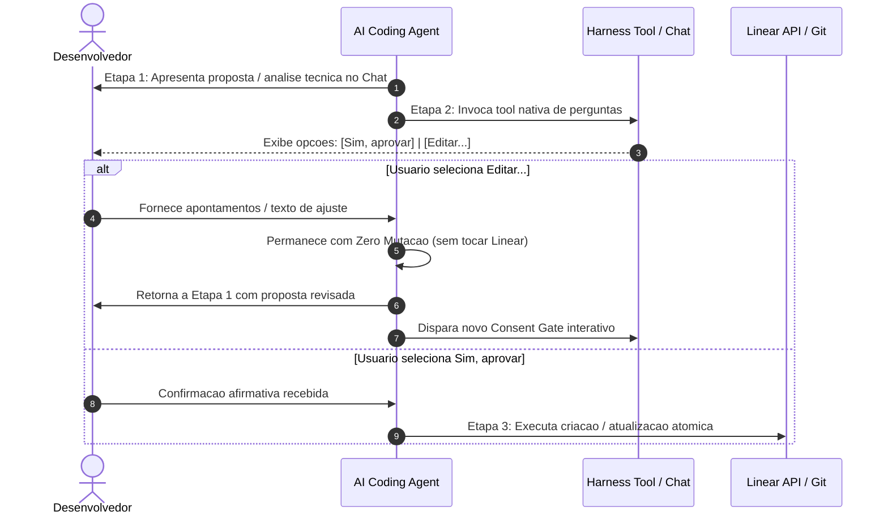

# Multi-Harness Command Architecture & Routing Reference

This reference documents how Linear lifecycle commands (`fk-new-issue`, `fk-technical-analysis`, `fk-develop`, `fk-fix`) operate across multiple AI coding harnesses (Google Antigravity, Claude Code, Cursor, and GitHub Copilot) through APM primitives.

---

## 1. Problem Statement: The Leading Slash Dilemma

In modern AI coding assistants, user interfaces handle leading slashes (`/`) inconsistently:

1. **Google Antigravity (`agy`)**:
   - Built-in slash commands (e.g. `/plan`, `/goal`, `/schedule`) are handled by the CLI client.
   - User-defined slash commands are mapped directly from `.agents/skills/<name>/SKILL.md`.
2. **Claude Code**:
   - Intercepts leading slash commands via `.claude/commands/<name>.md`.
3. **Cursor**:
   - Uses slash commands in Chat mapped to `.cursor/commands/<name>.md` or prompt rules in `.cursor/rules/`.
4. **GitHub Copilot**:
   - Supports slash commands via prompt templates in `.github/prompts/<name>.prompt.md`.
5. **Terminal / CLI Harnesses**:
   - Users typing `/fk-develop` or `/fk-fix` in CLI harnesses might collide with CLI-level parsing.

### Core Principle
**Developers must be able to use whichever syntax feels natural, and the agent must honor the lifecycle flow seamlessly with zero friction.**

```
+-----------------------------------------------------------+
|                        User Input                         |
|   "/fk-develop FAL-25"  OR  "fk-develop FAL-25"           |
|   "/fk-fix FAL-25"      OR  "fk-fix FAL-25"               |
+-----------------------------+-----------------------------+
                              |
                              v
+-----------------------------------------------------------+
|          Multi-Harness Interception & Tolerance           |
|                                                           |
|  [Antigravity]       [Claude Code]       [Cursor/Copilot] |
|  .agents/skills/     .claude/commands/   .cursor/rules/   |
|  .agents/rules/      .claude/rules/      .github/prompts/ |
+-----------------------------+-----------------------------+
                              |
                              v
+-----------------------------------------------------------+
|             Canonical linear-workflow Skill               |
|      (State machine, Consent Gate & Autonomous flow)      |
+-----------------------------------------------------------+
```

---

## 2. APM Primitives Mapping

To guarantee consistent behavior without vendor lock-in or duplicate documentation, the `linear-workflow` package organizes harness assets using APM primitives:

```
skills/linear-workflow/
├── .apm/
│   ├── instructions/
│   │   └── linear-lifecycle-commands.instructions.md  # Global rule interceptor
│   ├── prompts/
│   │   ├── fk-new-issue.prompt.md                    # Slash prompt template
│   │   ├── fk-technical-analysis.prompt.md           # Slash prompt template
│   │   ├── fk-develop.prompt.md                      # Slash prompt template
│   │   └── fk-fix.prompt.md                          # Slash prompt template
│   └── skills/
│       ├── fk-new-issue/SKILL.md                     # Antigravity promoted skill
│       ├── fk-technical-analysis/SKILL.md            # Antigravity promoted skill
│       ├── fk-develop/SKILL.md                       # Antigravity promoted skill
│       └── fk-fix/SKILL.md                           # Antigravity promoted skill
├── SKILL.md                                          # Core workflow engine
└── scripts/
    └── linear_api.py                                 # Zero-dependency API CLI
```

### Deployment Targets:
- **Google Antigravity**:
  - `skills/` promoted to `.agents/skills/fk-*/SKILL.md` (native slash commands).
  - `instructions/` compiled to `.agents/rules/` and `AGENTS.md`.
- **Claude Code**: `.claude/commands/` and rules in `.claude/rules/`.
- **Cursor**: `.cursor/commands/` and rules in `.cursor/rules/`.
- **Copilot**: `.github/prompts/` and instructions in `.github/instructions/`.

---

## 3. Syntactic Tolerance Standard

Agents must recognize all syntax permutations interchangeably:

| Canonical Command | Slash-Free Variant | Natural Language Equivalent |
| :--- | :--- | :--- |
| `/fk-new-issue` | `fk-new-issue` | *"vamos planejar tarefas no Linear"*, *"crie os cards para..."* |
| `/fk-technical-analysis` | `fk-technical-analysis` | *"vamos analisar o card FAL-12"*, *"spike técnico do FAL-12"* |
| `/fk-develop` | `fk-develop` | *"vamos desenvolver a tarefa FAL-12"*, *"implementar o card FAL-12"* |
| `/fk-fix` | `fk-fix` | *"aplicar correções do review no PR"*, *"resolver feedback de code review"* |

No matter which syntax the user inputs:
1. The agent intercepts the trigger immediately.
2. For planning and analysis (`/fk-new-issue`, `/fk-technical-analysis`), it passes through the mandatory **Consent Gate**.
3. For development (`/fk-develop`) and review fixes (`/fk-fix`), it executes autonomously without Consent Gate, moving immediately to `In Progress` and advancing to `In Review` upon PR creation.

---

## 4. Multi-Harness Interactive Consent Gate Protocol

### Behavioral Guarantee & Zero Mutation
Regardless of whether a command was triggered via a native slash command (`/fk-new-issue`, `/fk-technical-analysis`) or a plain prompt (`fk-new-issue`, `fk-technical-analysis` or natural language):
- **Zero Mutation**: Linear state updates (`update-issue`), comment creation, card creation (`create-issue`), and branch checkout are strictly forbidden prior to explicit developer confirmation in Stage 2.
- **Stage 1 (Presentation, Reading & Pre-Render Gate)**: Query card/project and render the full proposal visibly in the chat message before calling any question tool — either the complete task table (with title, description, acceptance criteria, status, and label `Front`, `Back`, or `Feature`/no tag for tooling/skills repos) in `/fk-new-issue` or the revised card title, updated card description, and complete 5-section technical specification in `/fk-technical-analysis`. Calling `ask_question` / `AskUserQuestion` without first rendering the full proposal in chat is strictly prohibited.
- **Stage 2 (Interactive Consent Gate with Embedded Summary)**: Invoke the native question tool of the active harness, embedding a concise summary of the proposal inside the `question` string itself and presenting structured choices:
  - `(Recommended) Sim, aprovar`: Proceed immediately to Stage 3.
  - `Editar...`: Free-form text input allowing the developer to request changes. The agent **loops back to Stage 1**, adjusts the plan/analysis, and triggers a new Consent Gate.
- **Stage 3 (Atomic Execution)**: On affirmative answer, update Linear state atomically, mandatorily updating the card title (`--title`) and description (`--description` / `--description-file`) alongside persisting the complete technical specification (all 5 sections) in the consolidated comment (`--comment`), then advance the card to `Todo`.
- **Autonomous Execution in /fk-develop**: Consumes the full technical specification persisted from Stage 3 directly from the Linear card/comments, ensuring zero context degradation across clean agent sessions.

### Harness-to-Tool Mapping Matrix

| Harness | Interactive Tool Support | Native Tool Name | Invocation Signature / Arguments | Fallback Mode |
| :--- | :--- | :--- | :--- | :--- |
| **Google Antigravity** (`agy` CLI / IDE) | ✅ Native Tool | `ask_question` | `{"questions": [{"question": "...", "options": ["(Recommended) Sim, aprovar", "Editar..."], "is_multi_select": false}]}` | Formatted Markdown chat prompt |
| **Claude Code** | ✅ Native Tool | `AskUserQuestion` | `{"question": "...", "options": ["Sim, aprovar", "Editar..."]}` | Formatted Markdown chat prompt |
| **OpenCode v2** | ✅ Native Tool | `question` / `ask` | `{"question": "...", "options": ["Sim, aprovar", "Editar..."]}` | Formatted Markdown chat prompt |
| **Cursor** | ⚠️ Fallback Textual | — | Markdown chat prompt com opções `1. (Recomendado) Sim, aprovar` e `2. Editar...` | Formatted Markdown chat prompt |
| **GitHub Copilot** | ⚠️ Fallback Textual | — | Markdown chat prompt com opções `1. (Recomendado) Sim, aprovar` e `2. Editar...` | Formatted Markdown chat prompt |
| **Gemini CLI** | ⚠️ Fallback Textual | — | Markdown chat prompt com opções `1. (Recomendado) Sim, aprovar` e `2. Editar...` | Formatted Markdown chat prompt |

### Loopback Flow on "Editar..."


### Standard Chat Fallback Format
When the active harness does not expose an interactive question tool:
```markdown
> [!IMPORTANT]
> **Consent Gate (Confirmação Explícita)**
> <pergunta de consentimento>
> 
> - **1. (Recomendado) Sim, aprovar**: Executar ações no Linear e prosseguir.
> - **2. Editar...**: Digite o que deseja ajustar no plano para retornarmos à Etapa 1.
```

---

## 5. Autonomous Commands Exception (`/fk-develop` & `/fk-fix`)

- **Explicit Exception to Consent Gate**: Execution commands operate autonomously without requiring upfront interactive confirmations:
  - **`/fk-develop`**: Reads issue requirements, transitions the issue to `In Progress` immediately with an initial comment citing the Gitflow branch, creates the branch, implements code and tests autonomously without pause, opens the GitHub PR, and moves the issue to `In Review`. The agent only asks questions in cases of genuine, blocking ambiguity; otherwise it assumes a sound technical premise, records it in the card comment and PR, and proceeds.
  - **`/fk-fix`**: Automatically parses open PR review feedback and comments, transitions the issue to `In Progress`, applies fixes directly on the PR branch, pushes commits, comments on the PR, and advances back to `In Review`.
- **Gold Rule**: Transition to `Done` remains strictly manual for developer completion after merging the PR.
