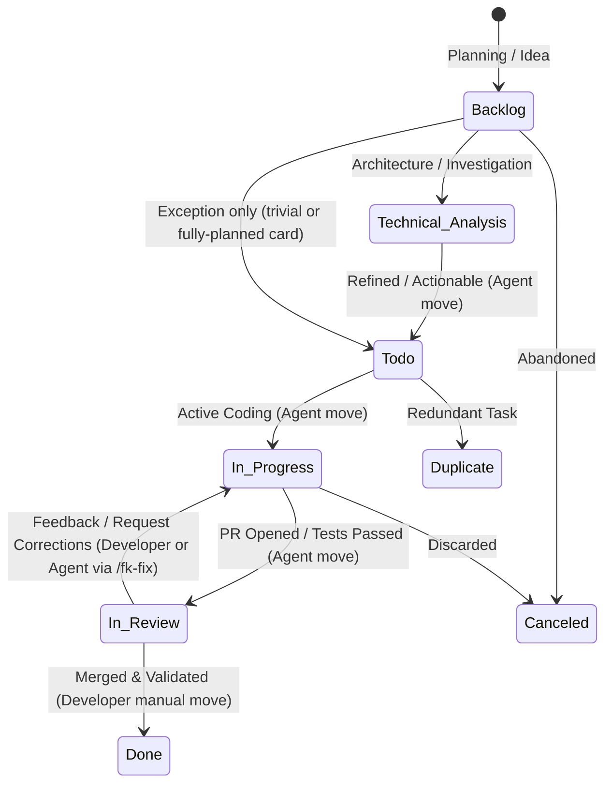

# Linear States, Lifecycle Transitions & Subproject Labeling

This reference details the official lifecycle state progression, rules for card movement, and automatic labeling strategies for monorepos and split projects (Frontend & Backend).

---

## 1. Linear Workflow State Machine

Every task tracked via `linear-workflow` follows this standard progression:



### State Definitions & Trigger Criteria

| State | Role & Description | When to Transition Here | Executado Por |
| :--- | :--- | :--- | :--- |
| **`Backlog`** | Unscheduled backlog items | **Default initial state** for every new card created via `/fk-new-issue`; cards go through `Technical Analysis` before `Todo`. | Desenvolvedor / Agente (`/fk-new-issue`) |
| **`Technical Analysis`** | Architecture design, spikes, research | When the agent is tasked with designing architecture, performing deep codebase analysis, or exploring technical alternatives before coding. | Agente (`/fk-technical-analysis`) |
| **`Todo`** | Actionable tasks ready for development | When a card has been refined with clear acceptance criteria and is ready to be picked up. | **Agente** (ao fechar Análise Técnica com Consent Gate) |
| **`In Progress`** | Active implementation | **As soon as coding begins** for a planned or newly created task, or when returned from review for corrections. | **Agente** (`/fk-develop`, `/fk-fix`) ou Desenvolvedor (para correções) |
| **`In Review`** | Quality verification, Pull Request, testing | When implementation is completed, automated tests pass, and a Pull Request is opened on GitHub. | **Agente** (ao abrir o PR e concluir o ciclo de codificação) |
| **`Done`** | Shipped and completed | When the Pull Request is merged or the user validates that the feature is fully delivered and operational. | **Transição manual pelo desenvolvedor** (após merge do PR no GitHub) |
| **`Canceled`** | Deprecated or obsolete | When the user explicitly cancels or abandons a planned feature. | Desenvolvedor |
| **`Duplicate`** | Redundant with existing issue | When the task overlaps completely with an existing Linear card. | Desenvolvedor |

> [!IMPORTANT]
> **Divisão de Responsabilidades & Ciclo de Feedback**:
> - **Papel do Agente**: Mover o card ao finalizar o desenvolvimento para **`In Review`** juntamente com o comentário de entrega contendo o link do PR.
> - **Papel do Desenvolvedor a partir de `In Review`**:
>   - Se houver falhas ou ajustes necessários: O desenvolvedor retorna o card para **`In Progress`** (ou aciona `/fk-fix`) e instrui o agente a efetuar as correções.
>   - Se a entrega estiver aprovada: O desenvolvedor realiza o merge do PR e move manualmente o card para **`Done`**. O agente nunca deve mover para `Done` automaticamente.

---

## 2. Subproject & Multi-Repository Matching

In many enterprise architectures, a single product in Linear spans multiple repositories or subprojects (e.g., Linear project **"Rent Easy"**, with codebases **"Rent Easy Frontend"** and **"Rent Easy Backend"**).

### Detection Rules

1. **Parent Project Resolution**:
   - If the local project name is `rent-easy-frontend`, `rent-easy-backend`, `renteasy_app`, etc., clean and normalize the name by stripping common suffixes (`frontend`, `backend`, `mobile`, `web`, `api`, `service`).
   - Match against Linear projects: a query for "Rent Easy Frontend" matches parent project **"Rent Easy"**.

2. **Automatic Label Application**:
   When creating or updating an issue in a matched project, inspect the local workspace nature and tech stack to apply the appropriate label:

   - **`Front`**:
     - Markers: Flutter (`pubspec.yaml`), React / Vue / Angular / Next.js / Svelte (`package.json` with frontend dependencies), iOS (`Podfile`), Android (`app/build.gradle`), HTML/CSS.
     - Folder/repo names containing: `frontend`, `web`, `mobile`, `ui`, `client`, `app`.
   
   - **`Back`**:
     - Markers: Spring Boot / Java (`pom.xml`, `build.gradle.kts`), Node.js backend (NestJS, Express, Fastify), Python API/server (FastAPI, Django, Flask), Go (`go.mod`), Rust (`Cargo.toml`), SQL migrations.
     - Folder/repo names containing: `backend`, `api`, `service`, `server`, `core`.

   - **`Feature` or No Component Label (Tooling, AI Skills & Infrastructure Repositories)**:
     - Markers: AI skill/bundle repositories (`apm.yml`, `.apm/`, `skills/`, `.agents/`), standalone CLIs, automation scripts, DevOps/infrastructure repos, or agnostic libraries (such as `fk_apm`).
     - **Rule**: Never force `Back` merely because a tooling or skills repository contains helper scripts in Python or Shell (`scripts/*.py`, `*.sh`). Use `--label "Feature"` (when creating feature/enhancement cards) or omit `--label` altogether.

3. **Fallback & Override**:
   - If `.linear.json` contains `"defaultLabels": ["Front"]`, `"defaultLabels": ["Back"]`, or `"defaultLabels": ["Feature"]`, that explicit setting takes precedence.
   - If a requested label (`Front`, `Back`, `Feature`) does not yet exist in Linear, `linear_api.py` creates it under the team; if no label applies (e.g., tooling repository without tag), omit `--label`.

---

## 3. Transparency & User Notifications

Every Linear transition or query must be communicated explicitly in the AI agent's response to the user.

### Standard Notification Templates

- **Task Found & Started**:
  > `📋 [Linear]: Task identificada no projeto Rent Easy: LIN-104 - "Implementar tela de listagem de imóveis". Status atualizado para 'In Progress'. Labels: ['Front'].`

- **Task Transitioned to Todo (Post-Technical Analysis)**:
  > `🔬 [Linear]: Análise técnica de LIN-104 concluída. Título e descrição do card atualizados e card avançado para 'Todo' com sumário técnico consolidado registrado.`

- **Development Concluded & Moved to In Review**:
  > `🔍 [Linear]: Desenvolvimento concluído e PR #45 aberto no GitHub. Task LIN-104 movida para 'In Review' para sua validação.`

- **Correction Cycle (Returned to In Progress)**:
  > `🔄 [Linear]: Task LIN-104 retornada para 'In Progress' para aplicação dos ajustes solicitados na revisão do PR #45.`

- **Reminder for Manual Done**:
  > `✅ [Linear]: PR #45 mergeado com sucesso. Lembrete: Mova o card LIN-104 manualmente para 'Done' no Linear.`

- **Project Not Found in Linear**:
  > `⚠️ [Linear]: Projeto 'NovoProjetoX' não encontrado no Linear. O desenvolvimento seguiu normalmente sem vincular cards.`

---

## 4. Linear Agent Interaction Guidelines (AIG Compliance)

In accordance with official Linear guidelines ([linear.app/developers/agents](https://linear.app/developers/agents)):

1. **Clear Identity Signaling**:
   - Every comment posted by the agent to a Linear issue must be clearly identified with an agent header to prevent confusion in team activity feeds:
     ```markdown
     🤖 **AI Agent Update**:
     - Status: Implemented & verified via automated tests.
     - Commits: `abc1234`
     - Notes: Added biometric authentication flow with fallback to PIN.
     ```
2. **Native Git Automation Integration**:
   - When creating Git branches (alongside `git-workflow`), use the standard Linear branch format `<type>/<identifier>-<slug>` (e.g., `feat/RENT-104-biometric-auth`).
   - Linear natively detects this branch name to automate issue tracking across Pull Requests.
3. **Context Enrichment & Technical Analysis Refinement**:
   - During general coding updates and PR reviews (`/fk-develop`, `/fk-fix`), never wipe human product notes arbitrarily; post progress updates via comments.
   - Upon concluding `/fk-technical-analysis` (Stage 3 after explicit developer Consent Gate approval), the agent **must** atomically update the card title (`--title`) and description (`--description` or `--description-file`) alongside the 5-section technical comment (`--comment`) and state (`--state "Todo"`), replacing outdated preliminary `Backlog` drafts with the refined architectural scope and acceptance criteria.
