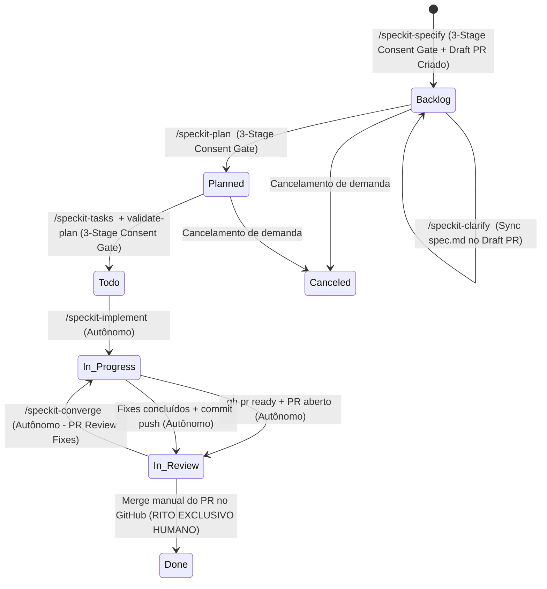

# Linear States, Lifecycle Transitions & Subproject Labeling (`github/spec-kit` Integration)

This reference details the official 6-stage lifecycle state progression, rules for card movement coupled with `/speckit-*` commands, Living Specs with Draft PRs, and automatic labeling strategies for monorepos, split projects (Frontend & Backend), and tooling packages.

---

## 1. Linear Workflow State Machine (6-Stage Canonical Lifecycle)

### Canonical State Definitions & Trigger Criteria

| Posição | Nome do Estado | Tipo Linear (`type`) | Cor Hex | Gatilho / Comando | Modo de Execução |
| :---: | :--- | :--- | :--- | :--- | :--- |
| **0.0** | `Backlog` | `backlog` | `#BEC2C8` | `/speckit-specify <descrição>` | **3-Stage Consent Gate** (Cria branch Gitflow & Draft PR) |
| **1.0** | `Planned` | `unstarted` | `#F2C94C` | `/speckit-plan <CARD-ID>` | **3-Stage Consent Gate** (Pesquisa, arquitetura & data model) |
| **2.0** | `Todo` | `unstarted` | `#4EA7FC` | `/speckit-tasks <CARD-ID>` | **3-Stage Consent Gate** (Checklist de tasks & `validate-plan`) |
| **3.0** | `In Progress` | `started` | `#F2994A` | `/speckit-implement <CARD-ID>`, `/speckit-converge <CARD-ID>` | **Autônomo (Sem Consent Gate)** |
| **4.0** | `In Review` | `started` | `#BB87FC` | Ao concluir tasks (`gh pr ready`) ou após fixes no `/speckit-converge` | **Autônomo (Sem Consent Gate)** |
| **5.0** | `Done` | `completed` | `#56D364` | Merge manual do Pull Request no GitHub | **Exclusivamente Manual pelo Desenvolvedor** |
| **6.0** | `Canceled` | `canceled` | `#828282` | Cancelamento ou descontinuação de demanda | Manual ou via comando de abort |

> **REGRA DE PROTEÇÃO INVIOLÁVEL**: Nenhuma ferramenta ou agente de IA tem permissão para transicionar cards para **`Done`**. Se `--state "Done"` for solicitado à CLI `linear_api.py`, a execução é sumariamente rejeitada com erro orientativo.

---

## 2. Living Specs & Ciclo de Draft PRs no GitHub

1. `/speckit-specify`: Criação de branch Gitflow (`<type>/<CARD-ID>-<slug>`), commit inicial de `spec.md`, push para o remote e abertura de Pull Request em modo Draft via `gh pr create --draft`. A URL pública do Draft PR é registrada no corpo do card em `Backlog`.
2. `/speckit-clarify <CARD-ID>`: Executa em worktree efêmero isolado (`.worktrees/<CARD-ID>`), grava clarificações em `spec.md` e envia commits para o Draft PR.
3. `/speckit-plan <CARD-ID>`: Executa em worktree efêmero isolado, adiciona `plan.md`, `research.md`, `data-model.md`, `quickstart.md`, comita no PR Draft e transiciona o card para `Planned`.
4. `/speckit-tasks <CARD-ID>`: Executa em worktree efêmero isolado, adiciona `tasks.md`, valida com `validate-plan`, comita no PR Draft e transiciona o card para `Todo`.
5. `/speckit-implement <CARD-ID>`: Executa autônomo, move para `In Progress`, completa todas as tarefas, promove o PR para pronto via `gh pr ready <pr-number>` e avança o card para `In Review`.
6. `/speckit-converge <CARD-ID>`: Executa autônomo, move para `In Progress`, resolve apontamentos de code review, comita na branch, comenta no PR e retorna para `In Review`.

---

## 3. Subproject & Component Labeling Rules

Quando criar ou atualizar uma issue no Linear, classifique o escopo conforme o ecossistema do projeto:

- **`Front`**: Flutter (`pubspec.yaml`), React, Vue, Angular, Next.js, Svelte, iOS, Android, Web/Mobile UI.
- **`Back`**: Spring Boot / Java, NestJS / Express / Fastify, Python FastAPI / Django / Flask, Go, Rust, serviços de banco de dados.
- **`Feature` ou Sem Tag (Tooling, Skills de IA e Repositórios de Infraestrutura)**:
  - Repositórios de pacotes de IA (`apm.yml`, `.apm/`, `skills/`, `.agents/`, `.specify/`), CLIs standalone, automações DevOps ou bibliotecas agnósticas (como `fk_apm`).
  - **Regra**: Nunca force `Back` pela mera presença de scripts auxiliares em Python ou Shell (`scripts/*.py`, `.specify/scripts/python/*.py`). Utilize `--label "Feature"` ou omita o argumento `--label`.

---

## 4. Agent Interaction Guidelines (AIG) & Payloads File-First UTF-8

1. **Identificador de Agente**: Prefixar todos os comentários com `🤖 **AI Agent Update**:`.
2. **Nomenclatura Gitflow**: `<type>/<CARD-ID>-<slug>` (ex: `feat/FAL-58-modernizar-linear-workflow-draft-prs`).
3. **Payloads File-First UTF-8**: Sempre passar descrições, comentários e corpos de PR através de arquivos UTF-8 temporários (`--description-file`, `--comment-file`, `--body-file`) sanitizados por `sanitize_markdown_payload()`. Nunca passar Markdown contendo aspas ou crases inline em argumentos shell.
