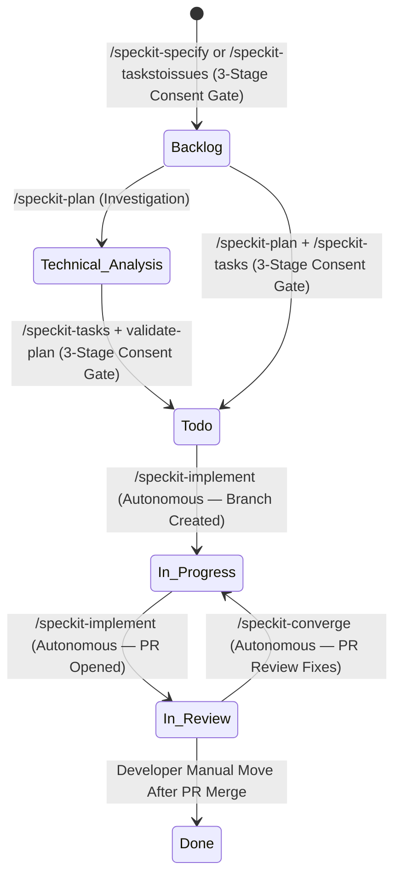

# Linear States, Lifecycle Transitions & Subproject Labeling (`github/spec-kit` Integration)

This reference details the official lifecycle state progression, rules for card movement coupled with `/speckit-*` commands, and automatic labeling strategies for monorepos, split projects (Frontend & Backend), and tooling packages.

---

## 1. Linear Workflow State Machine

### State Definitions & Trigger Criteria

| State | Role & Description | Trigger Command | Executed By |
| :--- | :--- | :--- | :--- |
| **`Backlog`** | Default initial state for newly specified cards | `/speckit-specify`, `/speckit-taskstoissues` | **Agent** (after 3-Stage Consent Gate) |
| **`Technical Analysis`** | Architectural investigation, `research.md`, `plan.md` | `/speckit-plan` | **Agent** / Developer |
| **`Todo`** | Actionable specification (`spec.md`, `plan.md`, `tasks.md`) validated via `validate-plan` | `/speckit-tasks` (or `/speckit-plan`) | **Agent** (after 3-Stage Consent Gate) |
| **`In Progress`** | Active coding on Gitflow branch `<type>/<issue-key>-<slug>` | `/speckit-implement`, `/speckit-converge` | **Agent** (Autonomous, NO Consent Gate) |
| **`In Review`** | All tasks in `tasks.md` completed (`[X]`), tests passing, and Pull Request opened/updated on GitHub | `/speckit-implement`, `/speckit-converge` | **Agent** (Autonomous upon PR open/update) |
| **`Done`** | Pull Request merged and validated | Manual action only | **Developer Only** (Agent NEVER moves to `Done`) |

---

## 2. Subproject & Component Labeling Rules

When creating or updating an issue in a matched Linear project, inspect the workspace tech stack:

- **`Front`**: Flutter (`pubspec.yaml`), React, Vue, Angular, Next.js, Svelte, iOS, Android, Web/Mobile UI.
- **`Back`**: Spring Boot / Java, NestJS / Express / Fastify, Python FastAPI / Django / Flask, Go, Rust, database services.
- **`Feature` or No Component Label (Tooling, AI Skills & Infrastructure Repositories)**:
  - AI skill/bundle repositories (`apm.yml`, `.apm/`, `skills/`, `.agents/`, `.specify/`), standalone CLIs, DevOps/infrastructure, or agnostic libraries (such as `fk_apm`).
  - **Rule**: Never force `Back` merely because a tooling or skills repository contains helper scripts in Python or Shell (`scripts/*.py`, `.specify/scripts/python/*.py`). Apply `--label "Feature"` or omit `--label`.

---

## 3. Agent Interaction Guidelines (AIG) & File-First UTF-8 Payloads

1. **Identity Header**: Prefix all Linear comments with `🤖 **AI Agent Update**:`.
2. **Gitflow Branch Naming**: `<type>/<issue-key>-<slug>` (e.g. `feat/FAL-53-spec-driven-development-linear-workflow`).
3. **File-First UTF-8 Payloads**: Always pass descriptions, comments, and PR bodies via UTF-8 files (`--description-file`, `--comment-file`, `--body-file`) sanitized by `sanitize_markdown_payload()`. Never pass inline Markdown containing backticks or quotes in shell arguments.
