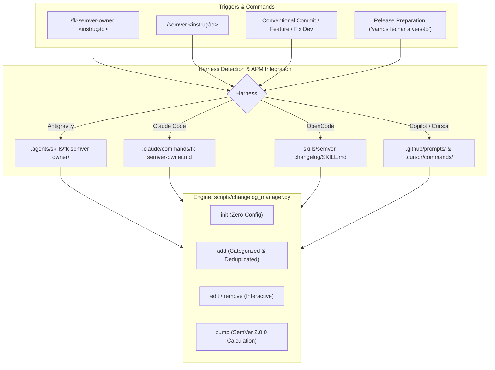
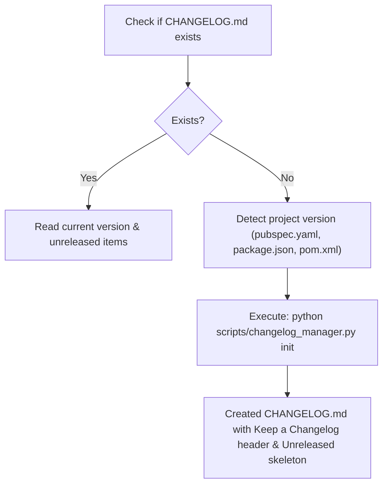

# SemVer & Changelog Workflow: Keep a Changelog 1.1.0 & SemVer 2.0.0

A standardized, deterministic workflow for AI coding agents to maintain `CHANGELOG.md` rigorously updated in compliance with [Keep a Changelog 1.1.0](https://keepachangelog.com/en/1.1.0/) and [Semantic Versioning 2.0.0](https://semver.org/spec/v2.0.0.html) throughout software development and release lifecycles.

Works seamlessly across **Google Antigravity**, **OpenCode**, **Claude Code**, **Cursor**, and **GitHub Copilot**.

---

## Core Non-Negotiable Standards

1. **Keep a Changelog 1.1.0 Adherence**:
   - Every project must maintain a single `CHANGELOG.md` in its root (or package root in monorepos).
   - Must use the official header and reverse chronological order.
   - Entries must be categorized strictly into the six standard categories:
     - `### Added`
     - `### Changed`
     - `### Deprecated`
     - `### Removed`
     - `### Fixed`
     - `### Security`
   - See [references/keep-a-changelog.md](references/keep-a-changelog.md) for detailed guidelines.

2. **Semantic Versioning 2.0.0 Strictness**:
   - Version identifiers strictly follow `X.Y.Z` (`MAJOR.MINOR.PATCH`).
   - Breaking changes require a `MAJOR` increment (or `MINOR` if currently in `0.y.z`).
   - Backward-compatible features (`Added`) require a `MINOR` increment.
   - Backward-compatible fixes and refactorings require a `PATCH` increment.
   - See [references/semver-spec.md](references/semver-spec.md) for full calculation rules.

3. **Deterministic State Mutation via Script**:
   - Agents should use the bundled Python manager `scripts/changelog_manager.py` for modifying `CHANGELOG.md` to eliminate markdown syntax errors, corrupted indentation, or accidental overwrites of existing notes.

4. **Preserve Human Notes**:
   - Never overwrite or erase pre-existing human notes in `## [Unreleased]`.
   - Never overwrite historical released version sections.

---

## Multi-Harness Architecture & Slash Commands

This skill supports canonical commands and interactive aliases across all AI coding harnesses:



---

## Workflow 1: Zero-Config Bootstrap (`init`)

When starting a project or when `CHANGELOG.md` is absent:



### Command:
```bash
python skills/semver-changelog/scripts/changelog_manager.py init
```

If a package manifest (`pubspec.yaml`, `package.json`, `pom.xml`, `pyproject.toml`, `Cargo.toml`) is present, `changelog_manager.py` automatically detects the current version and documents the initial release.

---

## Workflow 2: Incremental Maintenance during Development (`add`)

During feature development, bug fixes, or refactoring (e.g. while working on tasks from `linear-workflow` or `git-workflow`):

1. **Identify the change category**:
   - `feat` ➔ `Added`
   - `fix` ➔ `Fixed`
   - `refactor`, `perf`, `docs`, `chore`, `style` ➔ `Changed`
   - `deprecate` ➔ `Deprecated`
   - `remove` ➔ `Removed`
   - `security` ➔ `Security`
2. **Execute atomic addition**:
   ```bash
   python skills/semver-changelog/scripts/changelog_manager.py add <category> "<description>" --issue "<issue-key>"
   ```
   *Example:*
   ```bash
   python skills/semver-changelog/scripts/changelog_manager.py add feat "Implement Google OAuth2 login flow" --issue "FAL-23"
   ```
3. The script ensures deduplication and places the entry in the correct category under `## [Unreleased]`.

---

## Workflow 3: Interactive Developer Customization (`/fk-semver-owner`)

The developer can customize entries in `## [Unreleased]` using prompts or slash commands with optional delimiters:

```text
/fk-semver-owner Quero mudar o texto da mudança X e da Y para... Fim /
```

### Steps for the Agent:
1. Parse the developer's intent (editing wording, removing notes, or moving between categories).
2. **Edit entry**:
   ```bash
   python skills/semver-changelog/scripts/changelog_manager.py edit --target "<old text>" --replacement "<new text>"
   ```
3. **Remove entry**:
   ```bash
   python skills/semver-changelog/scripts/changelog_manager.py remove --target "<text to remove>"
   ```
4. Show the updated `## [Unreleased]` diff to the developer.

---

## Workflow 4: Release Bump & Version Calculation (`bump`)

When ready to finalize a release:

1. **Inspect status**:
   ```bash
   python skills/semver-changelog/scripts/changelog_manager.py status
   ```
2. **Execute Bump**:
   - Automatic calculation based on accumulated unreleased changes:
     ```bash
     python skills/semver-changelog/scripts/changelog_manager.py bump auto
     ```
   - Or specify explicit increment type:
     ```bash
     python skills/semver-changelog/scripts/changelog_manager.py bump patch
     python skills/semver-changelog/scripts/changelog_manager.py bump minor
     python skills/semver-changelog/scripts/changelog_manager.py bump major
     ```
   - Or specify explicit SemVer tag:
     ```bash
     python skills/semver-changelog/scripts/changelog_manager.py bump 1.2.0 --date 2026-10-21
     ```
3. **Outcome**:
   - The contents of `## [Unreleased]` are packaged into `## [X.Y.Z] - YYYY-MM-DD`.
   - A fresh `## [Unreleased]` block is created with clean empty category headings.
   - Markdown comparison links (if present) are updated.

---

## CLI Reference (`changelog_manager.py`)

| Subcommand | Arguments | Description |
| :--- | :--- | :--- |
| `init` | `[--version <ver>]` | Initializes `CHANGELOG.md` if not present |
| `add` | `<cat> <entry> [--issue <id>]` | Adds a bullet point under category in `[Unreleased]` |
| `edit` | `--target <txt> --replacement <txt>` | Modifies an existing bullet in `[Unreleased]` |
| `remove` | `--target <txt>` | Removes a bullet from `[Unreleased]` |
| `bump` | `[auto\|patch\|minor\|major\|<ver>] [--date <date>]` | Finalizes `[Unreleased]` into a released version |
| `status` | `[--json]` | Shows current version, unreleased stats, and proposed bumps |
