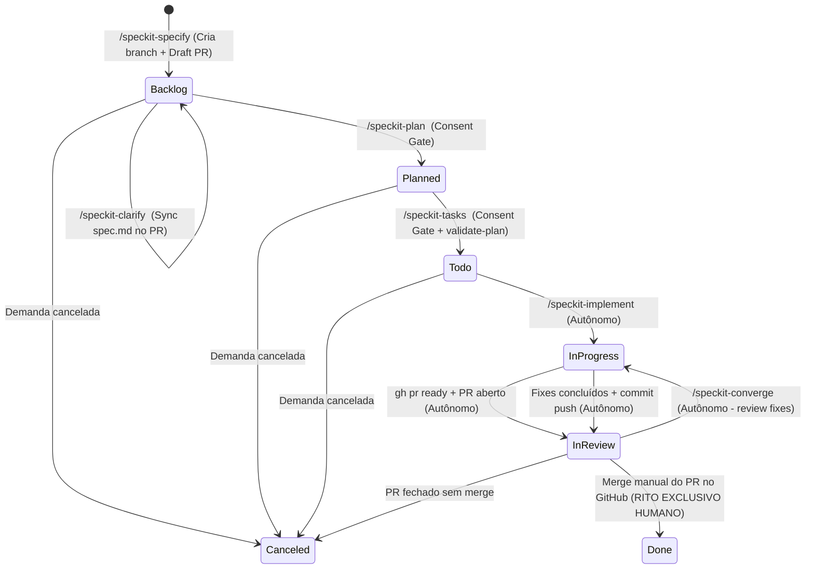

# Data Model: Living Specs & Draft PR Lifecycle com Linear Workflow e Sync de Boards

**Issue**: [FAL-58](https://linear.app/fallkey/issue/FAL-58/featworkflow-modernizar-linear-workflow-com-ciclo-draft-prs-e) | **Branch**: `feat/FAL-58-modernizar-linear-workflow-draft-prs` | **Date**: 2026-10-29

---

## 1. Entidades Principais

### 1.1 `LinearWorkflowState`
Representa um estado/coluna no quadro Kanban do Linear para um time específico.

| Campo | Tipo | Nullable | Descrição | Regras de Validação |
| :--- | :--- | :--- | :--- | :--- |
| `id` | String (UUID) | Não | Identificador único do estado no Linear | Gerado pelo Linear |
| `teamId` | String (UUID) | Não | Identificador do time proprietário do estado | Deve referenciar um time válido existente |
| `name` | String | Não | Nome legível da coluna | Um de: `Backlog`, `Planned`, `Todo`, `In Progress`, `In Review`, `Done`, `Canceled` |
| `type` | String (Enum) | Não | Tipo semântico de estado do Linear | Um de: `backlog`, `unstarted`, `started`, `completed`, `canceled` |
| `position` | Float | Não | Ordenação ordinal da coluna no board | Valores de 0.0 a 6.0 com incrementos regulares |
| `color` | String (Hex) | Não | Código de cor hexadecimal associado ao estado | Regex: `^#[0-9A-Fa-f]{6}$` |

#### Tabela Canônica de Estados Padronizados:
```json
[
  {"name": "Backlog", "type": "backlog", "position": 0.0, "color": "#BEC2C8"},
  {"name": "Planned", "type": "unstarted", "position": 1.0, "color": "#F2C94C"},
  {"name": "Todo", "type": "unstarted", "position": 2.0, "color": "#4EA7FC"},
  {"name": "In Progress", "type": "started", "position": 3.0, "color": "#F2994A"},
  {"name": "In Review", "type": "started", "position": 4.0, "color": "#BB87FC"},
  {"name": "Done", "type": "completed", "position": 5.0, "color": "#56D364"},
  {"name": "Canceled", "type": "canceled", "position": 6.0, "color": "#828282"}
]
```

---

### 1.2 `LivingSpecDraftPR`
Representa o Pull Request aberto no GitHub em modo Draft desde o início da especificação (`/speckit-specify`), abrigando a evolução contínua da documentação e código.

| Campo | Tipo | Nullable | Descrição | Regras de Validação |
| :--- | :--- | :--- | :--- | :--- |
| `prNumber` | Integer | Não | Número identificador do PR no repositório GitHub | Inteiro positivo |
| `branchName` | String | Não | Nome da branch Gitflow associada | Padrão: `<type>/<CARD-ID>-<slug>` (ex: `feat/FAL-58-modernizar-linear-workflow-draft-prs`) |
| `baseBranch` | String | Não | Branch de destino do PR | `develop` ou `main`/`master` |
| `title` | String | Não | Título convencional do PR | Padrão: `<type>(<CARD-ID>): <descricao-curta>` |
| `isDraft` | Boolean | Não | Indicador de modo rascunho (Draft) | `true` durante `specify`, `clarify`, `plan`, `tasks`; `false` após `implement` |
| `htmlUrl` | String | Não | URL web pública do Pull Request | Padrão: `https://github.com/<owner>/<repo>/pull/<number>` |
| `specFiles` | Array[String]| Não | Lista de arquivos Spec Kit versionados na branch | `spec.md`, `plan.md`, `research.md`, `data-model.md`, `quickstart.md`, `tasks.md` |

---

### 1.3 `LinearIssueContext`
Representa o card no Linear vinculado ao ciclo de vida do Spec Kit.

| Campo | Tipo | Nullable | Descrição | Regras de Validação |
| :--- | :--- | :--- | :--- | :--- |
| `id` | String (UUID) | Não | Identificador único interno do card | UUID válido |
| `identifier` | String | Não | Chave pública do card no time | Padrão: `^[A-Z]{2,10}-\d+$` (ex: `FAL-58`) |
| `title` | String | Não | Título da demanda | Convencional (`feat(...)`, `fix(...)`, etc.) |
| `description` | String | Sim | Descrição do card em Markdown | Deve ser processada por `sanitize_markdown_payload` |
| `state` | LinearWorkflowState | Não | Estado atual do card no board | Pertence ao conjunto de estados do time |
| `draftPrUrl` | String | Sim | URL do Draft PR no GitHub | Extraído do corpo da issue ou vinculado por link |
| `teamId` | String (UUID) | Não | Identificador do time do Linear | UUID válido |
| `projectId` | String (UUID) | Sim | Identificador do projeto associado | UUID válido se houver projeto ativo |

---

### 1.4 `EphemeralWorktreeContext`
Representa o contexto de isolamento de execução em um Git Worktree efêmero.

| Campo | Tipo | Nullable | Descrição | Regras de Validação |
| :--- | :--- | :--- | :--- | :--- |
| `cardId` | String | Não | Identificador do card alvo | Padrão: `^[A-Z]{2,10}-\d+$` (obrigatório em todos os comandos) |
| `targetBranch` | String | Não | Nome da branch Gitflow do card | Deve existir localmente ou no remote `origin` |
| `worktreePath` | String | Não | Caminho relativo do diretório do worktree | Padrão: `.worktrees/<CARD-ID>` (ignorado no `.gitignore`) |
| `isCurrentWorkspace`| Boolean| Não | Se o repositório raiz já está na branch alvo | Se `true`, opera no diretório atual sem criar worktree |
| `status` | String | Não | Ciclo de vida do worktree | `created`, `active`, `syncing`, `cleaned_up`, `failed` |

---

## 2. Diagrama de Transição de Estados (State Machine)



---

## 3. Regras de Integridade e Transição

1. **Anti-Estagnação com Consent Gate**:
   - Transições de `Backlog` para `Planned` e de `Planned` para `Todo` DEVEM passar pelo Consent Gate de 3 etapas com Pre-Render visual antes de qualquer mutação.
2. **Execução Autônoma sem Consent Gate**:
   - `/speckit-implement` e `/speckit-converge` operam com total autonomia para transição para `In Progress` e `In Review`.
3. **Bloqueio Inviolável de `Done`**:
   - O Linear API e todos os agentes rejeitam categoricamente qualquer solicitação de `--state "Done"`. Apenas o desenvolvedor humano transiciona para `Done` após validar o merge no GitHub.
4. **Isolamento de Worktree**:
   - Cada comando parametrizado garante a limpeza imediata (`git worktree remove --force` e `git worktree prune`), preservando arquivos locais não commitados na branch ativa do desenvolvedor.
