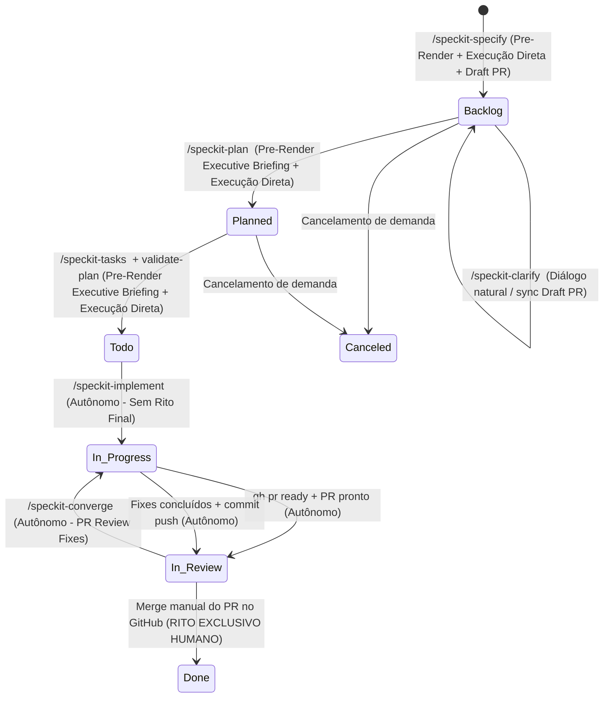

# Data Model: Política de Execução Orientada a Diálogo no Linear Workflow

**Issue**: [FAL-74](https://linear.app/fallkey/issue/FAL-74/featlinear-workflow-remover-rito-de-aprovacao-final-nas-etapas-speckit) | **Branch**: `feat/FAL-74-remove-consent-gate-rite` | **Date**: 2026-11-23

---

## 1. Entidades Principais

### 1.1 `SpeckitCommandExecutionPolicy`
Representa o contrato de execução, transição de estado no Linear e política de interação humana associado a cada um dos 10 comandos `/speckit-*` no ecossistema `linear-workflow`.

| Campo | Tipo | Nullable | Descrição | Regras de Validação |
| :--- | :--- | :--- | :--- | :--- |
| `commandName` | String | Não | Nome canônico do comando Spec Kit | Um dos 10 `/speckit-*` oficiais |
| `requiresCardId` | Boolean | Não | Se exige `<CARD-ID>` (`^[A-Z]{2,10}-\d+$`) como argumento | `true` para `clarify`, `plan`, `tasks`, `implement`, `converge` |
| `requiresPreRenderInChat` | Boolean | Não | Obrigatoriedade de renderizar resumo/briefing completo no chat antes ou junto da mutação | `true` para `specify`, `plan`, `tasks`, `taskstoissues` |
| `executionMode` | String (Enum) | Não | Modo operacional de execução do comando | Um de: `direct_dialogue_driven`, `autonomous`, `three_stage_consent_gate`, `interactive_governance`, `read_only` |
| `linearTransition` | String | Não | Transição no Linear executada pelo comando | `None`, `Create(Backlog)`, `Backlog->Planned`, `Planned->Todo`, `Todo->In Progress->In Review`, `In Review->In Progress->In Review` |
| `allowsFinalApprovalRite` | Boolean | Não | Se exige parada bloqueante final via `ask_question` / `AskUserQuestion` com `"Sim, aprovar"` / `"Editar..."` | `false` para `specify`, `plan`, `tasks`, `implement`, `converge`; `true` apenas para `taskstoissues` |

#### Matriz Canônica de Políticas dos 10 Comandos `/speckit-*`

| Comando | `requiresCardId` | `requiresPreRenderInChat` | `executionMode` | `linearTransition` | `allowsFinalApprovalRite` |
| :--- | :---: | :---: | :--- | :--- | :---: |
| `/speckit-constitution` | `false` | `false` | `interactive_governance` | `None` | `false` |
| `/speckit-specify` | `false` | `true` | `direct_dialogue_driven` | `Create(Backlog)` + Draft PR | `false` |
| `/speckit-clarify` | `true` | `false` | `interactive_governance` | `None` (sync Draft PR) | `false` |
| `/speckit-plan` | `true` | `true` | `direct_dialogue_driven` | `Backlog->Planned` | `false` |
| `/speckit-tasks` | `true` | `true` | `direct_dialogue_driven` | `Planned->Todo` | `false` |
| `/speckit-analyze` | `false` | `false` | `read_only` | `None` | `false` |
| `/speckit-checklist` | `false` | `false` | `interactive_governance` | `None` | `false` |
| `/speckit-taskstoissues` | `false` | `true` | `three_stage_consent_gate` | `Create(Backlog)` (lote) | `true` |
| `/speckit-implement` | `true` | `false` | `autonomous` | `Todo->In Progress->In Review` | `false` |
| `/speckit-converge` | `true` | `false` | `autonomous` | `In Review->In Progress->In Review` | `false` |

---

### 1.2 `PreRenderChatArtifact`
Representa a saída transparente obrigatória renderizada no texto visível do chat para evitar mutações silenciosas no Linear após a remoção do rito final de aprovação.

| Campo | Tipo | Nullable | Descrição | Regras de Validação |
| :--- | :--- | :--- | :--- | :--- |
| `commandName` | String | Não | Comando originador da renderização | Um de: `/speckit-specify`, `/speckit-plan`, `/speckit-tasks`, `/speckit-taskstoissues` |
| `cardSummaryTable` | MarkdownTable | Sim | Tabela de cards propostos (título convencional, coluna `Backlog`, label, projeto, resumo) | Obrigatório para `/speckit-specify` e `/speckit-taskstoissues` |
| `revisedTitle` | String | Sim | **Título Revisado** no padrão Conventional Commits | Obrigatório para `/speckit-plan` e `/speckit-tasks`; enviado via `--title` |
| `updatedDescription` | Markdown | Sim | **Descrição Atualizada** do card consolidando spec, plano e/ou tasks | Obrigatório para `/speckit-plan` e `/speckit-tasks`; enviado via `--description-file` |
| `fiveMandatorySections` | Array[String] | Sim | Resumo das 5 seções arquiteturais obrigatórias do `plan.md` | Obrigatório para `/speckit-plan` e `/speckit-tasks`; validado por `validate-plan` |
| `utf8PayloadFiles` | Array[String] | Não | Flags file-first UTF-8 utilizadas na persistência remota | Subconjunto de `--description-file`, `--comment-file`, `--body-file` (sanitizados via `sanitize_markdown_payload`) |

---

## 2. Máquina de Estados Atualizada (6 Estágios Canônicos sem Rito Final nas 4 Etapas)

> **Invariantes Preservados**:
> - `Done` continua sendo transição exclusivamente manual pelo desenvolvedor após revisão e merge do Pull Request (`linear_api.py` bloqueia `--state "Done"`).
> - `/speckit-taskstoissues` preserva o **3-Stage Consent Gate** por atuar na criação em lote de múltiplos sub-cards em `Backlog`.
> - Toda mutação de texto no Linear e GitHub continua utilizando payloads em arquivos UTF-8 sanitizados (`--description-file`, `--comment-file`, `--body-file`).
